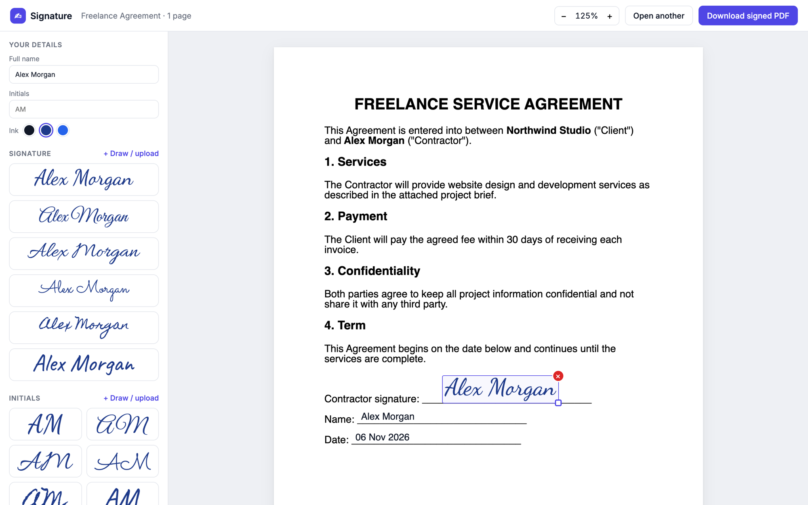

# ✍︎ Signature

**Sign your documents for free, without uploading them anywhere.**

Signature is a free, open-source e-signature app that runs entirely on your own computer. Open a PDF or Word document, drop in a signature, add the date, and download the signed PDF. That's it.



## Why we built this

Signing a document should be simple. Most e-signature platforms make it harder than it needs to be:

- **They charge you.** A few free signatures, then a monthly subscription just to put your name on a page.
- **They take your documents.** To sign anything, you have to upload contracts, agreements, IDs and financial papers to someone else's servers. You don't control where they're stored, who can see them, or how long they're kept.

Many of the documents we sign are the most sensitive ones we have. We didn't think you should have to pay, or hand them over to a third party, just to sign them.

So we built Signature:

- 💸 **Free forever.** No accounts, no subscriptions, no "upgrade to sign more".
- 🔒 **Your documents never leave your computer.** Everything runs locally. Files are opened, signed and saved on your machine. Nothing is uploaded to any cloud service.
- 🌍 **Open source.** You can read every line of code and check exactly what it does with your files.

## Features

- **Open PDF and Word documents** (`.pdf`, `.docx`, `.doc`, `.odt`, `.rtf`)
- **Ready-made signatures:** type your name once and get six handwriting styles plus matching initials, in black, navy or blue ink
- **Draw your signature** with a mouse or trackpad
- **Upload a photo of your real signature.** The white paper background is removed automatically.
- **Fields** for your name, today's date, free text and checkmarks
- **Click or drag to place** anything on the page, then move, resize or delete it
- **Download the signed PDF.** Dates and text stay real, selectable text.
- **Your signatures are remembered** in your browser for next time

## Getting started

### Requirements

- [Node.js](https://nodejs.org) 18 or newer
- [LibreOffice](https://www.libreoffice.org), only needed to open Word documents. PDFs work without it.

  ```bash
  # macOS
  brew install --cask libreoffice
  ```

### Run it

```bash
git clone https://github.com/Arhaans/Signature.git
cd Signature
npm install
npm run dev
```

Then open **http://localhost:5173** in your browser.

For a production build served from one port:

```bash
npm start
```

That serves the app at http://127.0.0.1:3001.

## How to sign a document

1. **Open a document:** drag a PDF or Word file into the window, or click **Open document**.
2. **Enter your name** under *Your details*. Ready-made signature and initials styles appear instantly.
3. **Place your signature:** click a style and then click on the page, or drag it straight onto the page.
4. **Add the date or other fields** from the *Fields* section. Double-click a text field to edit it.
5. **Adjust:** drag to move, pull the corner handle to resize, and press `Delete` or click **×** to remove.
6. Click **Download signed PDF**.

Want something more personal? Click **+ Draw / upload** to draw your signature, type it in a font of your choice, or upload a photo of your handwritten one.

## How it works

Everything happens on your machine:

| Part | What it does |
|------|--------------|
| Browser app (React + [pdf.js](https://mozilla.github.io/pdf.js/)) | Shows the document and lets you place signatures |
| [pdf-lib](https://pdf-lib.js.org) | Stamps your signatures onto the original PDF, right in your browser |
| Local helper server (Node + Express) | Converts Word files to PDF with LibreOffice, on `127.0.0.1` only |

The helper server only listens on your own computer (`127.0.0.1`), so nothing else on your network or the internet can reach it. Temporary files from Word conversion are deleted as soon as the conversion finishes.

### Project layout

```
server/index.js               Local server for Word → PDF conversion
src/App.jsx                   Document state, placing fields, download
src/components/               Sidebar, page view, draggable fields, signature creator
src/lib/sigImage.js           Turns typed names, drawings and photos into transparent PNGs
src/lib/exportPdf.js          Writes the fields onto the original PDF
```

## Good to know

- Signature adds a **visual signature**, like signing a printout by hand. It doesn't add a certificate-based digital signature or an audit trail, and it doesn't send documents to other people to sign. For many everyday documents a visual signature is all you need, but check what your document requires.
- Password-protected PDFs may not export correctly.

## Roadmap ideas

- Send a document to someone else to sign
- Certificate-based digital signatures
- Undo / redo
- Desktop app packaging

Have an idea? [Open an issue](https://github.com/Arhaans/Signature/issues).

## Contributing

Contributions are welcome! Fork the repo, make your change, and open a pull request. For bigger changes, open an issue first so we can talk it through.

## License

[MIT](LICENSE). Free to use, change and share.

Signature fonts are bundled through [Fontsource](https://fontsource.org) and are licensed under the SIL Open Font License.
